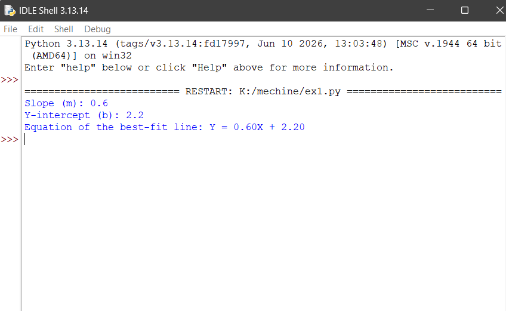

# Implementation of Univariate Linear Regression
## AIM:
To implement univariate Linear Regression to fit a straight line using least squares.

## Equipments Required:
1. Hardware – PCs
2. Anaconda – Python 3.7 Installation / Jupyter notebook

## Algorithm
1. Get the independent variable X and dependent variable Y.
2. Calculate the mean of the X -values and the mean of the Y -values.
3. Find the slope m of the line of best fit using the formula. 

4. Compute the y -intercept of the line by using the formula:

5. Use the slope m and the y -intercept to form the equation of the line.
6. Obtain the straight line equation Y=mX+b and plot the scatterplot.

## Program:
```
import numpy as np
import matplotlib.pyplot as plt

# Input independent variable X and dependent variable Y
X = np.array([1, 2, 3, 4, 5])
Y = np.array([2, 4, 5, 4, 5])

# Calculate mean of X and Y
mean_x = np.mean(X)
mean_y = np.mean(Y)

# Calculate slope (m)
m = np.sum((X - mean_x) * (Y - mean_y)) / np.sum((X - mean_x) ** 2)

# Calculate y-intercept (b)
b = mean_y - m * mean_x

# Display the equation
print("Slope (m):", round(m, 2))
print("Y-intercept (b):", round(b, 2))
print("Equation of the best-fit line: Y = {:.2f}X + {:.2f}".format(m, b))

# Calculate predicted Y values
Y_pred = m * X + b

# Plot the scatterplot and best-fit line
plt.scatter(X, Y, color='blue', label='Actual Data')
plt.plot(X, Y_pred, color='red', label='Best Fit Line')

plt.xlabel('Independent Variable (X)')
plt.ylabel('Dependent Variable (Y)')
plt.title('Univariate Linear Regression using Least Squares')
plt.legend()
plt.grid(True)
plt.show()


```

## Output:



## Result:
Thus the univariate Linear Regression was implemented to fit a straight line using least squares using python programming.